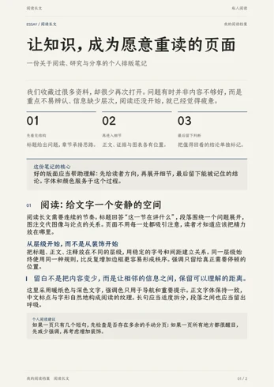
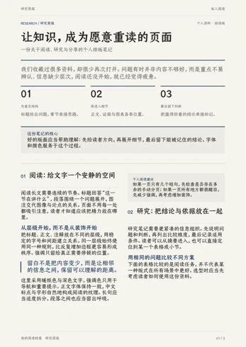
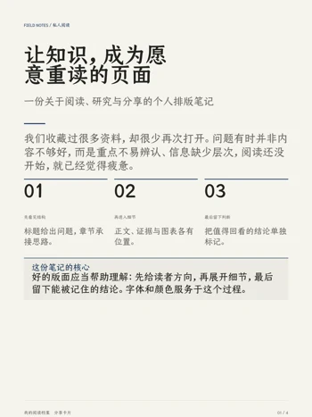

# 4evour 内容生产与可视化排版工作台

这个仓库把中文技术内容生产与可视化排版放到同一条流程里：先用 Skills 研究、写作和整理文案，再把 Markdown 交给本地 Web 工作台，制作小红书卡片、图片和 PDF。

仓库同时保留两套可运行的排版工作台：**MD2Card** 用于浏览器卡片排版，**Quarto Studio** 以 Quarto + Typst 为正文生成核心。两套应用独立运行，方便用同一篇文章对比。原有八个 Skills 和精选示例继续保留。

## 选择入口

| 你要做什么 | 从哪里开始 |
|---|---|
| 生成正式长文 PDF，可视化调整字体、颜色与纸张 | [Quarto Studio](apps/quarto-studio/README.md) |
| 制作分享卡片，实时调整字体、背景和分页 | [MD2Card / Markdown Studio](apps/markdown-studio/README.md) |
| 写八股母稿、原理讲解或有证据的技术文章 | [内容 Skills 导航](docs/skills-guide.md) |
| 把已有母稿改成小红书文案和卡片脚本 | [adapt-social-content](adapt-social-content/SKILL.md) |
| 检查中文表达，保留事实和作者声音 | [tech-writing-zh](tech-writing-zh/SKILL.md) |
| 查看已有内容和交付样例 | [精选示例](examples/README.md) |

## 两套独立的排版版本

| 版本 | 入口与默认端口 | 生成方式 |
|---|---|---|
| Quarto Studio | [启动说明](apps/quarto-studio/README.md) · `8766` | Markdown/QMD → Quarto → Typst → PDF，再从 PDF 预览和切页 |
| MD2Card 原版 | [启动说明](apps/markdown-studio/README.md) · `8765` | Markdown → 浏览器 CSS 排版与分页 → 卡片 PNG / 图像 PDF |

两套版本使用相同原文即可对照。具体原理、当前实现的优劣势与比较方法见 [排版链路对比](docs/rendering-comparison.md)。

## Quarto Studio：正式 PDF 与可视化控制台

以 **Quarto + Typst** 完成正文排版，右侧预览来自最终 PDF。控制台使用 Python 标准库和原生 HTML/CSS/JavaScript，无 npm 构建步骤。

- **11 套版式**：默认版式、7 套上游模板，以及 Kami 风格的阅读长文、研究简报、分享卡片；三套 Kami 分别采用单栏、双栏和按章节起页的结构。
- **字体与主题**：23 个字体选项，标题、正文、引用和代码可分别搭配；8 种主题，可调字号、行距、段距和边距。
- **PDF 纸面**：6 个纸面预设、7 种纹理，可自定义纸色、字色、强调色与纹理浓度。
- **正文组件**：Kami 版式支持导语、重点、引语、备注、指标、提示、编号步骤、胶囊标签和装饰分隔，提供 3 种组件外观。
- **自动预览**：停止输入约 0.5 秒后自动编译；编译期间保留旧预览，连续修改合并为最新任务，也可手动更新。
- **输出与草稿**：导出可选中文字的 PDF、150 DPI 逐页 PNG ZIP、原文和样式 JSON；草稿、附件在浏览器本地独立保存。

### Windows 快速启动

需要 Python 3.10+、Quarto 1.10+（内置 Typst 0.15+）；完整页面预览及 PNG 导出需要 Poppler。首次准备更纱字体还需要 7-Zip 或支持 7z 的 tar，详见 [字体说明](apps/quarto-studio/fonts/README.md)。

在仓库目录打开 PowerShell：

```powershell
cd apps/quarto-studio
.\start-studio.ps1
```

也可双击 [启动Quarto工作台.cmd](apps/quarto-studio/启动Quarto工作台.cmd)。首次启动会下载并校验字体，默认地址为 `http://127.0.0.1:8766/app/`；更换端口可运行 `.\start-studio.ps1 -Port 8768`。

### 三套 Kami 版式

以下缩略图来自实际生成的 PDF；详细结构、组件写法与适用场景见 [Kami 版式说明](apps/quarto-studio/resources/KAMI.md)。

| 阅读长文 · A4 单栏 | 研究简报 · A4 双栏 | 分享卡片 · 3:4 按章节起页 |
|---|---|---|
|  |  |  |

完整启动、命令行生成、资源来源和适配限制见 [Quarto Studio README](apps/quarto-studio/README.md)。

## MD2Card 可视化排版版本

工作台基于 **MD2Card** 的 MIT 开源源码改造，在浏览器中编辑 Markdown，右侧实时预览和自动分页。

- **字体选择**：12 个中文字体选项，标题、正文和引用可分别搭配；7 款新增开源字体在首次启动时下载并校验。
- **主题与颜色**：4 套卡片主题，可自定义强调色、背景色和正文色。
- **背景与版式**：纯色、细点纸、方格纸；字号、行距、段间距、边距、画布比例和封面模式均可调整。
- **图片管理**：导入本地图片并绑定 Markdown 引用，检查缺失及冲突。
- **三种导出**：PNG 图片包、与预览一致的卡片 PDF，以及 Quarto + Typst 生成的 Letter 长文 PDF。
- **本地工作**：服务默认只监听 `127.0.0.1`；草稿保存到当前浏览器，长文文件保存到应用的本地输出目录。

### Windows 快速启动

需要 Node.js 24+、Python 3.10+ 和 PowerShell 7。选择“长文 PDF”时还需要安装 Quarto；命令行导出逐页 PNG 时需要 Poppler。

在仓库目录打开 PowerShell：

```powershell
cd apps/markdown-studio
.\start-studio.ps1
```

也可以双击 [`启动排版工作台.cmd`](apps/markdown-studio/启动排版工作台.cmd)。首次运行会准备字体、执行 `npm ci` 并构建前端；之后打开本地工作台。

默认地址：`http://127.0.0.1:8765/app/`。端口被其他应用占用时：

```powershell
.\start-studio.ps1 -Port 8767
```

点击 **排版设置 → 字体配色** 开始调样式。完整安装、开发、导出说明和限制见 [工作台 README](apps/markdown-studio/README.md)。

### 三种导出的区别

| 导出 | 用途 | 页面与文字 |
|---|---|---|
| PNG ZIP | 小红书图文、分享卡片 | 每张卡片一张图片 |
| 卡片 PDF | 保留预览画布，按页分享 | 每张卡片一页，页面为图像 |
| 长文 PDF | 阅读或归档完整文章 | Letter 重新分页，文字可选中 |

长文 PDF 会接收字体、配色、背景和边距参数，但使用自己的文章模板，分页与卡片不同。Mermaid 在长文 PDF 中渲染为完整图片；卡片预览目前沿用上游的代码块展示。

## 从选题到交付

```text
选题与事实核实
  → 内容 Skills：研究 / 母稿 / 中文表达
  → adapt-social-content：平台文案与卡片脚本
  → 选择工作台：Quarto Studio / MD2Card
  → 调整版式、字体、纸面与组件，检查实际页面
  → 正式长文 PDF / 分享卡片 PDF / PNG 图片包
```

Skills 负责内容和事实边界；工作台负责排版和导出。先审核技术结论，再调整呈现方式。具体 Skill 的输入、输出和交接物见 [Skills 使用导航](docs/skills-guide.md)，既有待修问题见 [生命周期说明](docs/skill-lifecycle.md)。

## 仓库结构

```text
4evour-skills/
├── apps/quarto-studio/                # 独立 Quarto + Typst 控制台
├── apps/markdown-studio/              # 保留 MD2Card 版本与原有 PDF 链路
│   ├── md2card/                      # Preact + TypeScript 前端
│   ├── studio_server.py              # 本地静态服务和长文导出接口
│   ├── fonts/                        # 字体清单、固定版本和许可证
│   ├── scripts/                      # 字体准备、Markdown 转换与图片缩放
│   ├── styles/                       # Typst 主题与文章模板
│   └── templates/                    # 写作与视觉示例
├── bagu-explainer/                    # 面试母稿
├── adapt-social-content/              # 平台表达
├── tech-writing-zh/                   # 中文表达检查
├── write-concept-explainer/            # 原理讲解
├── research-open-source-project/      # 开源研究
├── write-professional-technical-article/ # 技术长文
├── guizang-social-card-skill/          # 确定性卡片排版
├── baoyu-xhs-images/                  # 生成式视觉
├── examples/                         # 已有精选内容示例
└── docs/                             # Skills 导航、状态和维护文档
```

## 开发与验证

Quarto Studio：

```powershell
cd apps/quarto-studio
python -m unittest discover -s tests -v
node --check web/app.js
node --test tests/auto-preview.test.mjs tests/components.test.mjs
```

当前包含 32 项 Python 测试和 12 项 JavaScript 测试，覆盖参数校验、原文保留、模板与字体许可、自动更新和组件插入。Node 仅用于开发检查，应用运行无需 Node。

MD2Card：

```powershell
cd apps/markdown-studio
python scripts/download-fonts.py
cd md2card
npm ci
npm test
npm run build
```

MD2Card 前端当前有 24 项测试，覆盖 Markdown 解析、图片绑定、分页和演示稿。长文导出还需检查实际 PDF、字体、图片与页边界。字体准备脚本固定上游版本并验证 SHA256；字体二进制、依赖、构建产物、个人稿件和导出文件不提交。

## 开源来源与许可证

本仓库包含不同来源的内容，按各自许可证处理：

- **Markdown Studio / MD2Card**：保留 [MIT License](apps/markdown-studio/md2card/LICENSE)，上游版本见 [UPSTREAM.json](apps/markdown-studio/md2card/UPSTREAM.json)，本地改动见 [LOCAL_CHANGES.md](apps/markdown-studio/md2card/LOCAL_CHANGES.md)。
- **MD2Card 新增中文字体**：来自 Google Fonts 官方仓库，各字体保留 SIL OFL 许可证；固定来源及校验值见 [字体清单](apps/markdown-studio/fonts/manifest.json)。
- **Quarto Studio 字体**：16 款开源字体保留对应许可和 [固定来源与校验值](apps/quarto-studio/fonts/manifest.json)；仓耳今楷 W04/W05 为独立许可字体，按个人阅读用途准备，详见 [许可记录](apps/quarto-studio/fonts/tsanger/LICENSE.txt)，不计入开源字体。字体二进制及本机 Windows 字体不随仓库分发。
- **Quarto Studio 模板与组件**：保留上游源码、各自许可证与适配后的运行文件，版本和来源见 [资源清单](apps/quarto-studio/resources/sources.json) 与 [资源库说明](apps/quarto-studio/resources/README.md)。
- **Kami 设计参考**：三套新结构使用原生 Typst 实现，参考项目的 MIT 许可证保存在 [KAMI-LICENSE](apps/quarto-studio/resources/KAMI-LICENSE)。
- **baoyu-xhs-images**：保留 [MIT License](baoyu-xhs-images/LICENSE)。
- **guizang-social-card-skill**：保留 [AGPL-3.0 License](guizang-social-card-skill/LICENSE) 和 [商业授权说明](guizang-social-card-skill/COMMERCIAL_LICENSING.md)。
- 其余内容 Skills 继续遵循各自已有声明；不将不同来源视为一套统一许可证。
